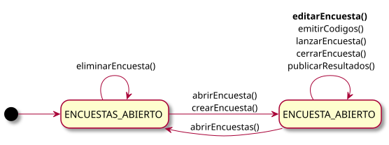

# `editarEncuesta()`: detallar y prototipar un caso de uso

Un caso de uso real, de PULSO (encuestas de satisfacción anónimas de la universidad), trabajado en dos pasos de la disciplina de requisitos.

## El caso de uso

El `GestorCalidad`, desde la ficha de una `Encuesta`, la edita. Una encuesta de campaña se edita con su campaña, no aquí. En Borrador se puede cambiar todo: Plantilla, nombre, programa, asignatura, curso académico, apertura, cierre y umbral mínimo de respuestas. En Abierta solo se amplía el cierre, porque el umbral queda fijo desde el lanzamiento: bajarlo tras ver la participación permitiría publicar resultados con menos respuestas de las comprometidas. Datos no válidos terminan sin cambios.

En el diagrama de contexto, `editarEncuesta()` es un bucle sobre la ficha de la encuesta:

||
|-|
|
Código fuente: [contexto.puml](contexto.puml)
|

## Detallar y prototipar

|Documento|Pregunta|
|-|-|
|[detallarCasoUso.md](detallarCasoUso.md)|¿Con qué notación se detalla? El caso de uso en prosa, escenario y extensiones, tabla, diagrama de actividad, pseudocódigo y diagrama de estados, y por qué el diagrama de estados es el que encaja con el resto del modelo|
|[prototiparCasoUso.md](prototiparCasoUso.md)|¿Qué se prototipa? El wireframe como cara de la presentación y el endpoint como cara del intercambio, y lo que el segundo descubre que el primero esconde|

Se leen en ese orden: el prototipo sale del detalle. Cada "Sistema presenta" y "Sistema permite" del diagrama de estados es a la vez algo que se ve en el wireframe y algo que se intercambia por el endpoint; cada rama roja, un mensaje en pantalla y un rechazo de la operación.

## Fuentes

|Fichero|Diagrama|
|-|-|
|[contexto.puml](contexto.puml)|Fragmento del diagrama de contexto del GestorCalidad|
|[estados.puml](estados.puml)|Detalle en diagrama de estados|
|[actividad.puml](actividad.puml)|Detalle en diagrama de actividad|
|[wireframes.puml](wireframes.puml)|Wireframes de Borrador y Abierta|
