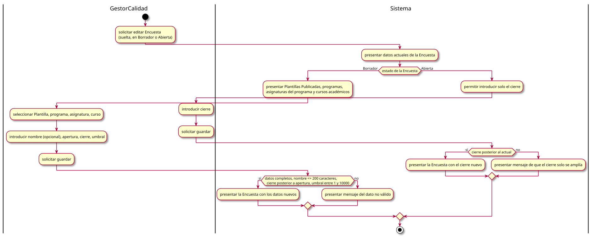
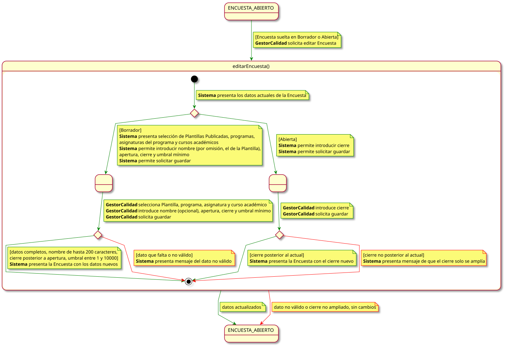
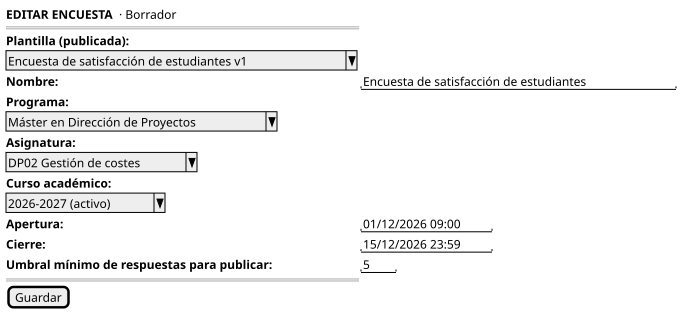
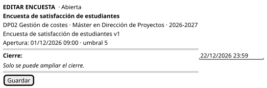
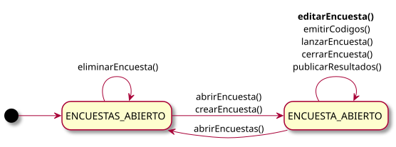

# Detallar un caso de uso: seis notaciones para `editarEncuesta()`

El [caso de uso](README.md) detallado con las notaciones habituales: prosa, plantilla de escenarios y extensiones, tabla, diagrama de actividad, pseudocódigo y diagrama de estados. Todas dicen exactamente lo mismo; cada una se ha escrito en su mejor versión, no como caricatura. La comparación está al final.

## Lo que todo detalle debe recoger

|#|Hecho|
|-|-|
|H1|Se entra desde la ficha de la Encuesta y se vuelve a ella|
|H2|Solo para una Encuesta suelta, en Borrador o Abierta|
|H3|El Sistema presenta los datos actuales y bifurca por estado|
|H4|Borrador: qué presenta el Sistema y qué introduce el GestorCalidad|
|H5|Borrador: datos completos, nombre de hasta 200 caracteres, cierre posterior a apertura, umbral entre 1 y 10000|
|H6|Abierta: solo se introduce el cierre, y debe ser posterior al actual|
|H7|Datos válidos: Encuesta actualizada. No válidos: mensaje y sin cambios|

## 1. Prosa

> El GestorCalidad, desde la ficha de una Encuesta suelta en Borrador o Abierta, solicita editarla, y el Sistema presenta sus datos actuales. Si está en Borrador, el Sistema presenta para seleccionar las Plantillas Publicadas, los programas, las asignaturas del programa y los cursos académicos, y permite introducir nombre (por omisión, el de la Plantilla), apertura, cierre y umbral mínimo. El GestorCalidad los introduce y solicita guardar. Si los datos están completos, el nombre no pasa de 200 caracteres, el cierre es posterior a la apertura y el umbral está entre 1 y 10000, el Sistema presenta la Encuesta con los datos nuevos; si no, presenta un mensaje con el dato no válido y no cambia nada. Si la Encuesta está Abierta, el Sistema solo permite introducir un cierre nuevo; si es posterior al actual, presenta la Encuesta con el cierre nuevo, y si no, un mensaje de que el cierre solo se amplía. En todos los casos el GestorCalidad sigue en la ficha de la Encuesta.

## 2. Escenario principal y extensiones

Plantilla de escenarios en el estilo de Cockburn ([*Writing Effective Use Cases*](https://www.informit.com/store/writing-effective-use-cases-9780201702255), Addison-Wesley, 2000), la más extendida en textos y empresas.

|Campo|Valor|
|-|-|
|Actor principal|GestorCalidad|
|Precondición|La ficha de una Encuesta suelta, en Borrador o Abierta, está abierta|
|Garantía mínima|La Encuesta no cambia si los datos no son válidos|
|Garantía de éxito|La Encuesta queda con los datos nuevos; el GestorCalidad sigue en su ficha|

**Escenario principal**

1. El GestorCalidad solicita editar la Encuesta.
2. El Sistema presenta los datos actuales y, para seleccionar, las Plantillas Publicadas, los programas, las asignaturas del programa y los cursos académicos.
3. El GestorCalidad selecciona Plantilla, programa, asignatura y curso académico, e introduce nombre (opcional), apertura, cierre y umbral mínimo.
4. El GestorCalidad solicita guardar.
5. El Sistema valida los datos.
6. El Sistema presenta la Encuesta con los datos nuevos.

**Extensiones**

- 2a. La Encuesta está Abierta:
  - 2a1. El Sistema presenta los datos actuales y permite introducir solo el cierre.
  - 2a2. El GestorCalidad introduce el cierre y solicita guardar.
  - 2a3. El Sistema presenta la Encuesta con el cierre nuevo. Fin.
  - 2a2a. El cierre no es posterior al actual: el Sistema presenta un mensaje de que el cierre solo se amplía. Fin, sin cambios.
- 5a. Falta un dato, el nombre pasa de 200 caracteres, el cierre no es posterior a la apertura o el umbral no está entre 1 y 10000: el Sistema presenta un mensaje con el dato no válido. Fin, sin cambios.

## 3. Tabla

Formato de hoja de cálculo: una fila por paso, con columnas para la condición y el paso siguiente.

|Paso|Actor|Acción|Condición|Siguiente|
|-|-|-|-|-|
|1|GestorCalidad|Solicita editar la Encuesta|Encuesta suelta, en Borrador o Abierta|2|
|2|Sistema|Presenta los datos actuales||3 si Borrador; 7 si Abierta|
|3|Sistema|Presenta Plantillas Publicadas, programas, asignaturas, cursos; permite introducir nombre, apertura, cierre, umbral||4|
|4|GestorCalidad|Selecciona e introduce los datos; solicita guardar||5 si válidos; 6 si no|
|5|Sistema|Presenta la Encuesta con los datos nuevos|datos completos, nombre <= 200, cierre > apertura, umbral 1-10000|Fin|
|6|Sistema|Presenta mensaje del dato no válido|algún dato no válido|Fin|
|7|Sistema|Permite introducir solo el cierre||8|
|8|GestorCalidad|Introduce el cierre; solicita guardar||9 si posterior; 10 si no|
|9|Sistema|Presenta la Encuesta con el cierre nuevo|cierre posterior al actual|Fin|
|10|Sistema|Presenta mensaje de que el cierre solo se amplía|cierre no posterior al actual|Fin|

## 4. Diagrama de actividad

Con calles por participante, que es su mejor versión para un caso de uso.

<div align=center>

||
|-|
|<div align=right><sup>Código fuente: [actividad.puml](actividad.puml)</sup></div>|

</div>

## 5. Pseudocódigo

```
caso de uso editarEncuesta(encuesta)
    requiere encuesta.suelta y encuesta.estado en {Borrador, Abierta}
    mostrar(encuesta)
    si encuesta.estado = Borrador
        mostrar(plantillasPublicadas, programas, asignaturas(programa), cursos)
        datos <- pedir(plantilla, programa, asignatura, curso, nombre?, apertura, cierre, umbral)
        si completos(datos) y longitud(datos.nombre) <= 200
           y datos.cierre > datos.apertura y 1 <= datos.umbral <= 10000
            encuesta.actualizar(datos)
            mostrar(encuesta)
        si no
            mostrarError(datoNoValido(datos))
    si no
        cierre <- pedir(cierre)
        si cierre > encuesta.cierre
            encuesta.cierre <- cierre
            mostrar(encuesta)
        si no
            mostrarError("el cierre solo se amplía")
```

## 6. Diagrama de estados

La notación del proyecto.

<div align=center>

||
|-|
|<div align=right><sup>Código fuente: [estados.puml](estados.puml)</sup></div>|

</div>

<div align=center>

|Borrador|Abierta|
|:-:|:-:|
|||
||<div align=right><sup>Código fuente: [wireframes.puml](wireframes.puml)</sup></div>|

</div>

## Comparación

Las seis versiones recogen H1 a H7: con suficiente texto, cualquier notación lo dice todo. Lo que cambia es qué se ve sin buscarlo, qué se puede comprobar mirando y con qué encaja el detalle.

### 1. El detalle es una ampliación del diagrama de contexto

En el diagrama de contexto del GestorCalidad (fragmento de la lista y la ficha de encuestas), `editarEncuesta()` es una transición de `ENCUESTA_ABIERTO` a `ENCUESTA_ABIERTO`:

<div align=center>

||
|-|
|<div align=right><sup>Código fuente: [contexto.puml](contexto.puml)</sup></div>|

</div>

El diagrama de estados del detalle es esa misma transición abierta: entra desde `ENCUESTA_ABIERTO`, sale a `ENCUESTA_ABIERTO`, con la misma notación. Del catálogo al contexto y del contexto al detalle hay un solo modelo, cada vez con más resolución.

En las demás notaciones, H1 es una frase: "desde la ficha", la precondición, "sigue en su ficha". Nada la conecta con el diagrama de contexto, y que coincidan depende de que alguien lo revise.

### 2. Las esperas son estados, y cada estado tiene su wireframe

Los dos estados vacíos del diagrama (`SolicitandoDatos`, `SolicitandoCierre`) son los momentos en que el Sistema ha presentado algo y espera al GestorCalidad. Corresponden uno a uno con los dos wireframes de la sección 6, Borrador y Abierta.

- En la actividad, la espera no existe: "introducir cierre" es una acción más en la calle del GestorCalidad, y entre la presentación y la acción solo hay una flecha que cruza de calle.
- En la prosa, el escenario y la tabla, la espera queda implícita entre dos pasos.
- En el pseudocódigo, es una llamada `pedir(...)` que devuelve un valor: la interacción convertida en entrada de una función.

Sin un elemento que represente "el Sistema espera con esto presentado", el wireframe no tiene dónde engancharse.

### 3. Las salidas son distintas y cada una tiene su postcondición

El diagrama de estados sale por dos transiciones: verde, "datos actualizados", y roja, "sin cambios". La actividad las une en un único `stop`, porque en un flujo el final es un punto, no un resultado. El pseudocódigo también: termina en la última línea, haya pasado lo que haya pasado. El escenario las separa, pero en dos sitios distintos: la garantía de éxito arriba y "Fin, sin cambios" dentro de cada extensión.

### 4. Las ramas son iguales

Borrador y Abierta son dos casos del mismo nivel. El escenario obliga a elegir uno como principal: Borrador queda en los pasos 1-6 y Abierta como "extensión 2a", con su propia extensión anidada (2a2a). La tabla lo resuelve con saltos ("3 si Borrador; 7 si Abierta") que hay que seguir con el dedo. En el diagrama de estados, las dos ramas salen del mismo `<<choice>>` y se dibujan igual.

### 5. La completitud se comprueba mirando

En el diagrama de estados, cada `<<choice>>` muestra todas sus salidas con su condición, cada camino llega a `[*]`, y el color dice si es éxito o fallo. Para saber si falta un caso basta mirar cada rombo: ¿las condiciones de salida cubren todas las posibilidades y no se solapan?

En el escenario, la misma comprobación exige recorrer cada paso y preguntarse si tiene extensión. La numeración (5a, 2a2a) lo permite, pero obliga a leer todo el texto, porque nada señala un paso que debería tener extensión y no la tiene.

### 6. Requisitos, no implementación

El pseudocódigo es el más preciso y el que más deriva hacia el diseño. `encuesta.actualizar(datos)` y `encuesta.cierre <- cierre` son operaciones del modelo. `asignaturas(programa)` es una dependencia entre datos. `datoNoValido(datos)` obliga a decidir cuál se informa si hay varios. Todo eso pertenece al análisis y al diseño, no al detalle.

Además, el pseudocódigo invita a escribir `repetir hasta que los datos sean válidos`, y el diagrama de actividad, a dibujar una flecha de vuelta al formulario. Las dos cosas contradicen una decisión del proyecto: un fallo termina el caso de uso, y se reintenta volviendo a invocarlo desde el contexto, como un bucle en `ENCUESTA_ABIERTO`. En el diagrama de estados esa decisión se lee directamente: el interior no tiene ciclos y la vuelta está en el diagrama de contexto.

### 7. La conversación se lee directamente

Cada transición del diagrama lleva lo que hace cada participante, en negrita: **Sistema** presenta o permite, **GestorCalidad** selecciona o solicita. Se lee como un diálogo entre los dos. La actividad también separa participantes, con calles, a costa de que cada intercambio sea una flecha cruzando de lado a lado (en este caso, cinco cruces). La prosa y el pseudocódigo no separan participantes.

## Dónde gana cada una

Las otras notaciones tienen su sitio; no en el detalle de un caso de uso que forma parte de un modelo de contexto.

|Notación|Gana en|
|-|-|
|Prosa|Contárselo a alguien que no lee diagramas (secretaría, dirección). Resumen de una línea en un catálogo|
|Escenario y extensiones|Garantía mínima explícita. Es texto: se compara bien entre versiones y no necesita herramienta|
|Tabla|Derivar casos de prueba fila a fila|
|Actividad|Procesos de negocio que cruzan varios casos de uso y actores, con concurrencia (`fork`/`join`)|
|Pseudocódigo|Algoritmos, en diseño: el barajado de respuestas al cerrar una encuesta, por ejemplo|
|Estados|Detalle de un caso de uso: interacción, esperas, ramas, salidas y encaje con el contexto en un solo artefacto|

El coste del diagrama de estados es la herramienta y la maquetación: notas largas en las transiciones y un trazado automático (PlantUML) que hay que vigilar. Se compensa con el punto 1: es el único detalle que se integra en el diagrama de contexto en vez de acompañarlo.
