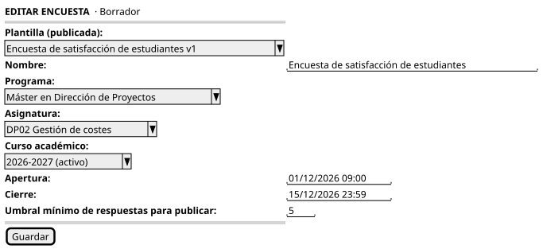
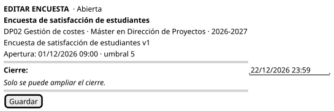

# Prototipar un caso de uso: wireframe y endpoint para `editarEncuesta()`

Prototipar se asocia a pantallas. Un prototipo es una versión de la interfaz que se puede inspeccionar, o usar, para validar los requisitos antes de construir el sistema. La interfaz es la frontera entre el actor y el sistema: para una persona, una pantalla; para otro sistema, una API. Y aunque el actor sea una persona, la pantalla no es el sistema sino uno de sus clientes: la frontera real es la API, que la pantalla recorre.

Un endpoint también es, por tanto, un prototipo. Este documento lo muestra con el mismo [caso de uso](README.md) detallado en [detallarCasoUso.md](detallarCasoUso.md).

## Cuando el actor es un sistema

La portada del servidor donde corre PULSO muestra la versión de cada aplicación. Para eso, cada aplicación ofrece una operación de solo lectura y sin sesión:

```
GET /api/version
-> {"version": "0.4.0", "esquema_version": 3}
```

El formato se acordó entre las dos partes antes de implementarlo, y la portada se construyó contra ese acuerdo. Eso es prototipar: la interacción con el actor, validada antes de existir. No hay wireframe posible, porque ninguna persona mira esa respuesta.

## Cuando el actor es una persona: las dos caras

Cada elemento del diagrama de estados de `editarEncuesta()` tiene una cara en la pantalla y otra en el intercambio:

|Diagrama de estados|Wireframe|Endpoint|
|-|-|-|
|**Sistema** presenta los datos actuales|La ficha|`GET /api/encuestas/{id}`|
|**Sistema** presenta selección de Plantillas, programas, asignaturas, cursos|Los desplegables|`GET /api/encuestas/opciones`|
|**Sistema** permite introducir los datos|Los campos|El cuerpo de la petición|
|**GestorCalidad** solicita guardar|`[Guardar]`|`PUT /api/encuestas/{id}`|
|Rama verde|La ficha con los datos nuevos|`200` con la Encuesta|
|Rama roja: dato no válido, o el cierre no se amplía|El mensaje|`422`|
|Salvaguarda: el estado ya no lo admite|(no se ofrece)|`409`|

<div align=center>

|Borrador|Abierta|
|:-:|:-:|
|||
||<div align=right><sup>Código fuente: [wireframes.puml](wireframes.puml)</sup></div>|

</div>

```
PUT /api/encuestas/{id}
{
  "plantilla_id": 3,
  "nombre": "Encuesta de satisfacción de estudiantes",
  "celda_programa_id": 10,
  "celda_asignatura_id": 101,
  "celda_curso_academico_id": 2,
  "apertura": "2026-12-01T09:00:00+01:00",
  "cierre": "2026-12-22T23:59:00+01:00",
  "umbral_minimo": 5
}
-> 200 | 422 dato no válido | 409 el estado no lo admite
```

## Lo que el endpoint enseña y el wireframe esconde

El wireframe de Abierta tiene un solo campo: el cierre. La pantalla impide enviar otra cosa, así que no puede plantear qué pasa si llega otra cosa. El endpoint recibe el cuerpo completo y tiene que responder:

|Pregunta|Respuesta del endpoint|
|-|-|
|En Abierta llega un umbral distinto del actual|`409`: el umbral queda fijo desde el lanzamiento|
|En Abierta llega un nombre distinto del actual|`409`|
|En Abierta no llega nombre|Se conserva el actual|
|En Borrador no llega nombre|Se conserva el actual (un nombre vacío, en cambio, vuelve al de la plantilla)|
|Llega una Encuesta de campaña|`409`: se edita con su campaña|

Ninguna de estas preguntas surge mirando las pantallas: el formulario siempre envía el nombre, y la ficha de una encuesta de campaña no ofrece editarla. Pero cualquiera puede llamar al endpoint sin pasar por la pantalla, de modo que el sistema necesita una respuesta para cada caso. En PULSO, la del nombre ausente en Borrador se descubrió revisando el endpoint: el nombre se perdía, y ninguna prueba en pantalla lo habría detectado.

La pantalla restringe la entrada; la API no. Por eso el prototipo del intercambio saca a la luz requisitos que el de la presentación oculta.

## Lo que el endpoint no prototipa

- **La presentación.** Qué se ve, en qué orden, qué es opcional, que el nombre se rellena con el de la plantilla mientras no se escriba otro. Eso es el wireframe.
- **La correspondencia uno a uno.** Los dos wireframes (Borrador y Abierta) caen en un solo `PUT`: el `<<choice>>` por estado lo resuelve el servidor. A la vez, una pantalla usa varios endpoints: la ficha, las opciones y el guardado.

## Fidelidad: el endpoint es diseño, el contrato es requisito

El verbo HTTP, la ruta, JSON y la autenticación son decisiones de diseño, igual que la tipografía y la disposición de una pantalla. En los requisitos, el wireframe es de baja fidelidad: cajas y textos, no la pantalla final. El prototipo del intercambio, en los requisitos, también:

```
editarEncuesta(datos) -> Encuesta | dato no válido | el estado no lo admite
```

Operación, qué entra, qué sale y qué rechazos tiene; sin verbo ni ruta. El endpoint concreto llega en diseño. Este contrato está muy cerca de la operación que el análisis asigna al controlador del caso de uso: la frontera entre prototipo del intercambio y análisis es más estrecha que la que hay entre wireframe y diseño de pantalla.

## Conclusión

El prototipo de un caso de uso tiene dos caras: la presentación (wireframe) y el intercambio (contrato de la operación). Para un actor persona se prototipan las dos; para un actor sistema, solo la segunda. Las dos se derivan del mismo detalle: cada "presenta" y "permite" del diagrama de estados es a la vez algo que se ve y algo que se intercambia, y cada rama roja, un mensaje y un rechazo.

Ejercicio: con el wireframe de Abierta delante, ¿qué debe pasar si alguien envía un umbral nuevo? La pantalla no permite ni plantear la pregunta; el endpoint obliga a contestarla.
