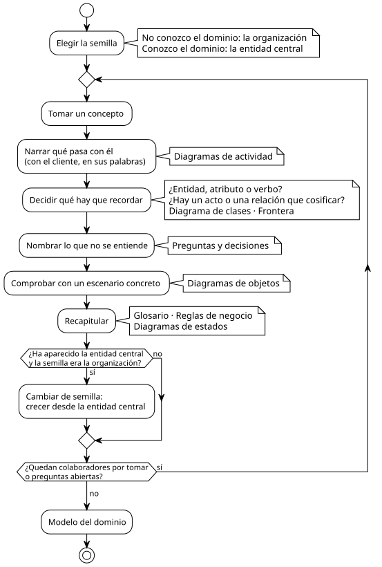

# Propuesta de construcción del Modelo del Dominio

## ¿Por qué?

Los pasos habituales (listar clases candidatas, representarlas, añadir asociaciones, añadir atributos, iterar) dicen qué se produce, pero no responden a las preguntas que más bloquean a quien modela:

|Pregunta sin responder|Consecuencia|
|-|-|
|¿Por dónde se empieza?|Se extraen los sustantivos del texto del cliente: el modelo depende de lo que el cliente dijo, no de lo que hay|
|¿Hasta dónde se llega?|O se queda corto, o crece sin límite hasta "HistorialCambiosDireccionClienteConValidacion"|
|¿Qué se hace con lo que no se entiende?|Se inventa, o se omite|
|¿Qué es el modelo del dominio?|Se reduce al diagrama de clases, y se pierden los procesos, las reglas y las palabras del cliente|

## ¿Qué?

### El modelo del dominio es un conjunto de artefactos

Cada artefacto responde a una pregunta sobre la realidad del cliente. El diagrama de clases es uno más.

|Pregunta|Artefacto|Qué recoge|
|-|-|-|
|¿Cómo lo llaman y qué significa aquí?|**Glosario**|Cada término del cliente, con su definición en *este* dominio|
|¿Qué se hace hoy, y quién lo hace?|**Diagramas de actividad**|Los procesos actuales, con una calle por rol|
|¿Qué hay que recordar y cómo se relaciona?|**Diagrama de clases**|Conceptos, asociaciones, multiplicidades y atributos|
|¿Es verdad?|**Diagramas de objetos**|Escenarios concretos y casos límite, para contrastar con el cliente|
|¿Cómo cambia lo más importante?|**Diagramas de estados**|El ciclo de vida de las entidades centrales|
|¿Qué no puede pasar?|**Reglas de negocio**|Restricciones, escritas con los términos del glosario|
|¿Dónde termina?|**Frontera**|Lo que quedó como atributo o fuera del modelo, y por qué|
|¿Qué no sabemos aún?|**Preguntas y decisiones**|Dudas abiertas, respuestas del cliente y decisiones tomadas|

El glosario cose el conjunto: todo término que aparece en un artefacto está en el glosario, y con el mismo nombre en todos.

Los diagramas de secuencia o de colaboración solo tienen cabida aquí entre personas, roles u organizaciones. Mensajes entre clases es repartir responsabilidades, y eso es diseño.

### Una entidad nunca es un verbo

|Sustantivos|Verbos|
|-|-|
|Van al diagrama de clases y al glosario|Van a los procesos (actividad), a las transiciones (estados) y, más adelante, a los casos de uso|

Pero muchas de las entidades más importantes nacen de un verbo o de una relación que el negocio necesita recordar. A eso se le llama **cosificación** (o reificación, de *res*, cosa):

|Se cosifica|Ejemplo|Señal|
|-|-|-|
|Un acto|vender → **Venta**|El negocio necesita recordar que ocurrió, con detalle|
|Una relación|Socio–Ejemplar → **Préstamo** Alumno–Asignatura → **Matrícula**|La relación tiene datos propios o un ciclo de vida. En UML, *clase asociación*|

Prueba sencilla: si admite "una X", "esta X", "las X de ayer", si se puede contar y señalar, es candidata a entidad. "Vender" no la pasa; "venta", sí.

Ante cada acto del negocio hay tres salidas:

|El negocio necesita…|El acto queda como|
|-|-|
|Recordarlo con detalle, consultarlo, verlo cambiar|Entidad (*Venta*)|
|Saber solo que ocurrió y cuándo|Atributo (*fechaAlta*)|
|Nada: solo que se pueda hacer|Verbo, fuera del diagrama de clases|

### La frontera: colaborador o valor

Un concepto es **entidad** si el negocio se interesa por él por sí mismo; es **atributo** si solo interesa su valor.

|¿Tiene identidad propia?|¿Tiene estados?|¿Se relaciona con otros conceptos?|¿El negocio pregunta por él de forma independiente?|
|:-:|:-:|:-:|:-:|

Cuantos más síes, más entidad. La misma palabra cambia de lado según el problema: *Dirección* es atributo en una tienda y entidad en una empresa de logística.

Los atributos de los conceptos más alejados del centro marcan dónde termina el modelo. La frontera se mueve con las iteraciones: un atributo se promueve a entidad cuando empieza a necesitar atributos propios o cuando lo comparten varios conceptos.

## ¿Para qué?

|Para…|Porque…|
|-|-|
|Saber por dónde empezar|Hay dos puntos de entrada explícitos, según cuánto se conozca el dominio|
|Saber cuándo parar|La frontera colaborador/valor da límites al modelo, y quedan documentados|
|No inventar|Lo que no se entiende se convierte en pregunta para el cliente, no en suposición|
|Saber cuándo está completo|Cada artefacto contesta una pregunta: está completo cuando la pregunta está respondida y validada|
|Llegar a los casos de uso|Los verbos de los procesos y las transiciones de estado de la entidad central son candidatos a caso de uso|
|Dejar evidencia del trabajo con el cliente|Las preguntas, respuestas y decisiones son un artefacto más, no un anexo|

## ¿Cómo?

### Dos puntos de entrada, un mismo ciclo

||No conozco el dominio|Conozco el dominio|
|-|-|-|
|**Problema**|La ignorancia|El exceso: todo parece relevante|
|**Semilla**|La organización: lo único que sé nombrar ("la tienda")|La entidad central (*Venta*, *Préstamo*, *Encuesta*…)|
|**Ante la duda**|Concepto: aún no sé si importa|Atributo: mi problema es limitar|
|**Riesgo**|Inventar un dominio que "suena bien"|Ceguera del experto: modelar *mi* dominio, no el del cliente|

Son el mismo ciclo con distinta semilla:

|||
|-|-|
|**Tomar un concepto**|Al inicio, la semilla. Después, cada concepto que haya aparecido.|
|**Narrar qué pasa**|Con el cliente y en sus palabras: qué se hace con él, quién, en qué orden. Queda como diagrama de actividad.|
|**Decidir qué hay que recordar**|De cada cosa que aparece en la narración: ¿entidad, atributo o verbo? ¿hay un acto o una relación que cosificar?|
|**Nombrar sin entender**|No es impedimento nombrar conceptos que aún no se entienden: se anotan como preguntas.|
|**Comprobar con objetos**|Un escenario concreto, como diagrama de objetos, delante del cliente: ¿esto pasa así?|
|**Recapitular**|Nuevos conceptos a tomar, nuevos términos al glosario, nuevas reglas, preguntas respondidas.|

El ciclo termina cuando lo que queda por tomar ya no son colaboradores sino valores, y no quedan preguntas abiertas.

### Cuando no se conoce el dominio

Es el *[Flipping on the Beach](https://github.com/mmasias/PRG2/blob/main/documentos/03-colaboracion/README.md)* de PRG2 llevado al dominio: descendente y guiado por el comportamiento. Las clases no salen de descomponer el todo en partes, sino de preguntar quién se encarga de lo que pasa. Pero es un método de diseño, y hay que traducirlo:

|Flipping (diseño)|Modelo del dominio|
|-|-|
|Clase raíz con `main` (`Juego`, `Aplicacion`)|La organización. Es andamio: casi nunca queda en el modelo|
|Método público (`jugar()`)|Lo que pasa en el negocio, contado por el cliente|
|Mensaje a un método que aún no existe|Concepto que aún no se entiende: pregunta para el cliente|
|Atributo que es objeto de otra clase|Asociación, nunca atributo|
|Atributo primitivo|Atributo|
|Cada objeto crea los suyos|Los conceptos existen por su cuenta: el Cliente existe antes que la Venta. Composición solo si hay dependencia existencial real|
|Recapitular|Validar con el cliente|

La semilla es un sustantivo (la organización); el motor son sus verbos. El primer acto o relación que el negocio necesita recordar, y que por tanto hay que cosificar, suele ser la entidad central. En ese momento se cambia de punto de entrada.

Lo modelado hasta entonces fue para aprender: es andamio, no entregable.

### Cuando se conoce el dominio

Se empieza por la entidad central, que casi siempre es un acto o una relación cosificados, y se crece hacia fuera. Cada concepto nuevo pasa por la frontera colaborador/valor, y ante la duda se queda como atributo.

Conocer el dominio en general no es conocer esta organización: el vocabulario se valida con el cliente con más cuidado, no con menos.

### El estado de la entidad central

Con la entidad central identificada, su diagrama de estados es el artefacto que más rinde: sus transiciones son verbos del negocio, candidatos directos a caso de uso. En [`editarEncuesta()`](../editarEncuesta/README.md), los estados *Borrador* y *Abierta* de la Encuesta ordenan el caso de uso entero.

### Ejemplo: [Firibicundio](mddFiribicundio.md)

|Paso|Resultado|
|-|-|
|Semilla|La tienda (no se conoce el dominio)|
|Narrar|"Vendemos artículos", "registramos cómo se pagó", "cada venta se captura en un registro"|
|Cosificar un acto|vender → **Venta**: tiene fecha, hora y líneas. Es la entidad central|
|Cosificar una relación|Venta–Artículo con cantidad → **LineaDeVenta**|
|Cosificar un acto|pagar → **Pago**: tiene cantidad|
|Frontera|*Tienda*: entidad (tiene nombre, dirección y artículos). *cantidad*, *fecha*, *hora*: atributos|
|Pregunta|"Registro" se describe como "historial de todas las ventas por tienda": no tiene identidad propia, es el conjunto de Ventas de una Tienda. ¿O el cliente se refiere a la caja donde se cobra? Se le pregunta antes de modelarlo|

### Antipatrones de esta propuesta

|Antipatrón|Síntoma|Ejemplo|
|-|-|-|
|**La raíz es el sistema**|El modelo descompone el software, no la organización|`SistemaCocina`|
|**Verbos disfrazados de clase**|Descomposición funcional con nombre de objeto|`GestorVentas`, `ProcesarPedido`|
|**Sobre-cosificación**|Todo acto se convierte en cosa, se pregunte o no por él|`EventoDeAlta`, `HistorialDe…`|
|**Atributo-objeto**|Un colaborador anotado como atributo en lugar de como asociación|`tienda: Tienda`, `ventaID`|
|**Colaboración entre clases**|Mensajes entre conceptos: es reparto de responsabilidades, es decir, diseño|`usarObjeto(Objeto)`|
|**Entregar el andamio**|Se entrega el árbol exploratorio como modelo del dominio|`Empresa` que lo compone todo|

